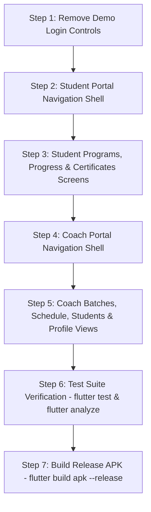

# SELFFITS Mobile App — Student & Coach Functionality Gap Audit

**Audit Date:** October 22, 2026  
**Audited Directory:** `/Users/macbook/Desktop/selffits`  
**Flutter Application:** `/Users/macbook/Desktop/selffits/mobile`  
**Production Target:** `https://selffits.com`  
**Production Commit Baseline:**  
- Student Dashboard API: `b6082b26b9de26a043b0c829046eff405c32a5e3`  
- Coach Dashboard API: `026639f2ee22a1246c03fc5cf8c8686010a4546d`  

---

## 1. Executive Summary

A comprehensive, strictly read-only audit was executed across the **Next.js web application** (`app/`, `actions/`, `components/`, `prisma/schema.prisma`), the **live production APIs** on `https://selffits.com`, and the **Flutter mobile codebase** (`mobile/lib/`, `mobile/test/`).

### Key Findings:
1. **Coach Portal Backend is 100% Complete & Production-Ready:**  
   The deployed `GET /api/v1/coach/dashboard` API already returns the complete coach profile, live metrics, hero upcoming class with meeting link, all assigned batches with clock timings, and full student rosters with martial arts disciplines. The mobile coach implementation is not blocked by missing APIs; it simply requires breaking down a single 972-line monolithic scrolling screen (`coach_home_screen.dart`) into structured navigation (Dashboard, Batches, Schedule, Students, Profile).

2. **Student Portal Backend is Partially Available in Production:**  
   `GET /api/v1/student/dashboard` is live and authoritative for the active membership, remaining classes, expiry date, assigned batch, countdown, coach info, and authorized Google Meet access. However, secondary website views—such as full enrollment history (`/dashboard/programs`), official certificates gallery (`/dashboard/certificates`), and belt progression details (`/dashboard/progress`)—either rely on NextAuth cookie-session server actions or have their endpoints quarantined.

3. **Inaccessible & Hidden Mobile Functionality:**  
   The mobile codebase already contains rich UI components (such as student rosters in coach batches, attendance progress bars, and a full notifications feed screen in `mobile/lib/features/notifications/`), but they are either squashed into accordions, hidden behind single-screen layouts, or wired to quarantined endpoints (`/api/v1/notifications` returning 404 in production).

4. **Demo Quick-Fill Controls Require Safe Removal:**  
   `StudentLoginScreen` contains quick-fill pills for `student@selffits.com` and `coach@selffits.com`. These are purely client-side conveniences and can be removed without touching the real authentication flow (`AuthNotifier`, `AuthRepository`, `FlutterSecureStorage`).

5. **Strict Change Control:**  
   No code, files, or database records were modified during this audit. Implementation will commence only after explicit approval.

---

## 2. Website Versus Mobile Feature Matrix

| Feature | Website Implementation | Existing Mobile Implementation | Actual Gap | Required Change | Complexity |
|---|---|---|---|---|---|
| **Authentication & Session** | NextAuth + Argon2 password hashing (`lib/auth.ts`, `actions/auth.actions.ts`) | `AuthRepository`, `AuthNotifier`, `FlutterSecureStorage` (`mobile/lib/features/auth/`) | None. Works against live production `POST /api/v1/auth/login` and `GET /api/v1/auth/me`. | Maintain token storage, session restoration, and expiry handling. | **Low** |
| **Demo Login Controls** | None (Website has no demo buttons) | `StudentLoginScreen` lines 67–83 & 267–344 (`_fillDemoStudent`, `_fillDemoCoach`) | Mobile displays demo autofill pills on login screen. | Remove demo methods, pills, and update test in `auth_module_test.dart:471`. | **Low** |
| **Role Guard & Isolation** | Role enum in middleware & server actions (`STUDENT`, `COACH`, `ADMIN`) | `AuthGatekeeper` (`mobile/lib/app.dart:58-93`), `AuthUser.isStudent`, `AuthUser.isCoach` | None. Correctly routes students to student portal and coaches to coach portal. | Preserve role guards; reject cross-role access. | **Low** |
| **Student Dashboard Overview** | `app/(student)/dashboard/page.tsx`, `StudentDashboardView.tsx` | `StudentHomeScreen` (`mobile/lib/features/student/presentation/student_home_screen.dart`) | Mobile uses a single scrolling column without bottom navigation or drawer. | Reorganize into a shell with bottom navigation + drawer. | **Low** |
| **Student Membership & Classes** | `getStudentEnrollmentAction()` (`actions/payments.actions.ts:415-548`) | `StudentEnrollmentSummary` in `student_dashboard_data.dart:37-83` | None for active enrollment; displays remaining/total classes, expiry, and days left. | Reuse existing dashboard provider data in UI. | **Low** |
| **Student Live Class & Google Meet** | `getCentralClassReadinessForUser()` (`actions/batch.actions.ts:16-160`) | `StudentClassReadiness` in `student_dashboard_data.dart:86-151`, `ClassStatusCalculator` | Working. Accurately evaluates time-to-class and unlocks Google Meet when authorized. | Preserve launcher logic; link to dedicated Live Class tab/view. | **Low** |
| **Student "My Programs"** | `app/(student)/dashboard/programs/page.tsx`, `StudentProgramsView.tsx` | Single active enrollment summary displayed in `StudentHomeScreen` | Dedicated screen missing; multi-program history not returned by mobile API. | Build `StudentProgramsScreen` displaying active program details and catalog link. | **Medium** |
| **Student "My Progress" (Attendance)** | Calculated from `Enrollment.totalClassesGranted - remainingClasses` | Calculated in `StudentEnrollmentSummary.completedClasses` & `progressPercentage` | Working on home screen progress bar; dedicated progress tab missing. | Create dedicated `StudentProgressScreen` featuring attendance & completion metrics. | **Low** |
| **Student "My Progress" (Belt & Exams)** | `getStudentDashboardProgressAction()` (`actions/student-progress.actions.ts:807-913`) | Only `classReadiness.levelName` is currently returned in dashboard payload | `StudentProfile.currentBelt`, `beltAwardedAt`, and `Batch.examDate` not in mobile API. | Present current level from readiness payload; add clean empty/info state for exam date. | **Medium** |
| **Student "My Certificates"** | `getStudentCertificatesAction()` (`actions/certificates.actions.ts:124-149`) | None in mobile codebase | Missing mobile screen; mobile API endpoint does not exist. | Create `StudentCertificatesScreen` with Luxury White design, verified badge, and empty state. | **Medium** |
| **Certificate PDF Download** | `/api/certificates/download/[id]/route.ts` | None | Web download uses NextAuth cookie session (`await auth()`); rejects mobile Bearer JWT (401). | Certificate download on mobile is blocked until endpoint accepts Bearer JWT. | **High** |
| **Student Profile & Settings** | `app/(student)/dashboard/profile/page.tsx` (`StudentProfile` table) | `user.name`, `user.email`, `user.role` in `authProvider`; logout in AppBar | Missing dedicated Profile view; phone, country, and emergency contact not in mobile API. | Build `StudentProfileScreen` displaying student identity, session status, and logout. | **Medium** |
| **Student Notifications** | `db.notification` table, `actions/notifications.actions.ts:7-24` | `NotificationBadgeButton`, `NotificationsScreen` (`features/notifications/`) | `/api/v1/notifications` is quarantined (returns 404 in production). | Use live `unreadNotificationsCount` from dashboard; do not connect quarantined route. | **Low** |
| **Coach Dashboard Overview** | `app/(coach)/coach/dashboard/page.tsx`, `CoachDashboardView.tsx` | `CoachHomeScreen` (`mobile/lib/features/coach/presentation/coach_home_screen.dart`) | Working. Shows welcome banner, Sensei verification, and live class countdown. | Reorganize into structured navigation tabs (Dashboard, Batches, Schedule, Students). | **Low** |
| **Coach Assigned Batches** | `Batch` table filtered by `coachId` (`actions/coach.actions.ts:104-134`) | `batches[]` in `CoachDashboardData`, rendered in accordion in `CoachHomeScreen` | Batches are present in data but buried in a single long scroll view. | Create dedicated `CoachBatchesScreen` / tab with batch cards, capacity, and schedule. | **Low** |
| **Coach Enrolled Students Roster** | `BatchStudent` relation (`actions/coach.actions.ts:111-131`) | `batch.students[]` & `allStudents[]` in `coach_dashboard_data.dart:102-180` | Roster data exists in memory but is hidden inside accordion items. | Create dedicated `CoachStudentsScreen` / tab listing all enrolled students with search. | **Low** |
| **Coach Class Schedule** | `calculateNextClassSession()` in `actions/coach.actions.ts:146` | `upcomingClass` and `batches[].nextSession` in `coach_dashboard_data.dart` | Schedule data exists in memory but lacks a dedicated schedule timeline view. | Create dedicated `CoachScheduleScreen` / tab organizing sessions chronologically. | **Low** |
| **Coach Google Meet Launcher** | `CoachUpcomingClassCard.tsx` (`b.meetingUrl`) | `_handleStartMeeting()` in `CoachHomeScreen:48-114` | None. Works when URL is present in database. | Maintain verified Google Meet launching behavior via `url_launcher`. | **Low** |
| **Coach Profile & Credentials** | `CoachApplication` table (`actions/coach.actions.ts:80-99`) | `CoachProfileData` in `coach_dashboard_data.dart:47-88` (rank, disciplines, email, phone) | Profile data exists in memory but lacks a dedicated Profile screen. | Create dedicated `CoachProfileScreen` displaying verified instructor credentials and logout. | **Low** |
| **Coach Notifications** | `db.notification` table | None | `/api/v1/notifications` is quarantined. | Safe empty state / information notice; exclude quarantined endpoint. | **Low** |
| **Quarantined Enrollment/Payment** | Razorpay checkout & webhook (`app/api/webhooks/razorpay/route.ts`) | Quarantined (`mobile/lib/features/public/presentation/enrollment_checkout_screen.dart`) | Quarantined endpoint (`/api/v1/student/enroll`) must remain excluded. | Do not connect fake payment or bypass Razorpay. Keep quarantined. | **High (Risk)** |
| **Quarantined Coupon Validation** | `actions/coupons.actions.ts` | Quarantined (`mobile/lib/features/student/repositories/student_repository.dart:30-52`) | Quarantined endpoint (`/api/v1/coupons/validate`) must remain excluded. | Keep quarantined. | **High (Risk)** |

---

## 3. Existing but Hidden or Inaccessible Functionality

1. **Coach Enrolled Students Roster:**  
   - **File:** `mobile/lib/features/coach/presentation/coach_home_screen.dart` (lines 799–821)  
   - **Status:** The mobile app already receives the full list of enrolled students for every batch from `GET /api/v1/coach/dashboard`. However, students are hidden inside an expandable accordion (`_expandedBatchIds`). Coaches have no dedicated "Students" tab or global roster view, despite the data being fully loaded in Riverpod state (`coachDashboardProvider`).

2. **Coach Batches & Schedule Details:**  
   - **File:** `mobile/lib/features/coach/presentation/coach_home_screen.dart` (lines 631–760)  
   - **Status:** Batch schedules, day combinations, time slots, clock timings, and capacity indicators are loaded and parsed in `CoachBatchSummary`, but they are stacked vertically below the hero card on a single 972-line screen. A dedicated "Batches" and "Schedule" tab will immediately expose this functionality with zero backend changes.

3. **Student Attendance Calculations:**  
   - **File:** `mobile/lib/features/student/models/student_dashboard_data.dart` (lines 62–67)  
   - **Status:** `StudentEnrollmentSummary` automatically computes `completedClasses`, `progressFraction`, and `progressPercentage`. This data is currently rendered as a single linear progress bar inside `student_home_screen.dart:793–843`. It can be highlighted in a dedicated "My Progress" screen without new API calls.

4. **Notifications Screen & Deep Link Navigator:**  
   - **Files:** `mobile/lib/features/notifications/presentation/notifications_screen.dart`, `mobile/lib/features/notifications/services/deep_link_navigator.dart`  
   - **Status:** A complete Luxury White notifications feed screen and deep-link handler exist in the codebase. However, tapping notifications triggers `HttpNotificationService.fetchNotifications()`, which calls `/api/v1/notifications`—an endpoint that is quarantined and returns 404 in production.

---

## 4. Features Genuinely Missing from Mobile

1. **Structured Navigation Shells (Student & Coach):**  
   - **Current State:** Both `StudentHomeScreen` and `CoachHomeScreen` are monolithic scrolling views without bottom navigation bars or side drawers.
   - **Required:**
     - `StudentMainShell`: Bottom navigation with 4 tabs (`Dashboard`, `My Programs`, `My Progress`, `My Certificates`) + AppBar Profile menu / Side Drawer (`Profile & Settings`, `Logout`).
     - `CoachMainShell`: Bottom navigation with 4 tabs (`Dashboard`, `Batches`, `Schedule`, `Students`) + AppBar Profile menu / Side Drawer (`Sensei Profile`, `Logout`).

2. **Student "My Programs" Screen:**  
   - **Website Equivalent:** `app/(student)/dashboard/programs/page.tsx`
   - **Mobile State:** Missing.
   - **Capability:** Mobile can immediately render the student's active enrollment details (Program Title, Category, Tier, Total Classes, Remaining Classes, Schedule, Days Remaining) using data from `studentDashboardProvider`.

3. **Student "My Certificates" Screen:**  
   - **Website Equivalent:** `app/(student)/dashboard/certificates/page.tsx`
   - **Mobile State:** Missing.
   - **Capability:** Can be implemented with a Luxury White card layout displaying certificate details, verified badges, and an informative empty state explaining that certificates are issued upon passing batch examinations.

4. **Student "My Progress" Screen:**  
   - **Website Equivalent:** `app/(student)/dashboard/progress/page.tsx`
   - **Mobile State:** Missing.
   - **Capability:** Can display attendance metrics, completion percentage, active belt level, and batch training schedule.

5. **Student & Coach "Profile & Settings" Screens:**  
   - **Website Equivalents:** `app/(student)/dashboard/profile/page.tsx`, `components/coach/coach-shell.tsx`
   - **Mobile State:** Only minimal name/email display and logout buttons exist in app bars.
   - **Capability:** Dedicated screens showing account identity, hardware-backed session status, role badge, support contact, and secure logout.

---

## 5. API and Backend Dependencies

### A. Live Production APIs (Verified Working)
1. `GET /api/v1/public/catalog`:
   - Returns program categories, membership tiers, pricing, and master coaches.
2. `POST /api/v1/auth/login`:
   - Authenticates credentials against Argon2 password hashes. Issues JWT Bearer token.
3. `GET /api/v1/auth/me`:
   - Verifies Bearer JWT and returns authenticated user identity.
4. `GET /api/v1/student/dashboard` (Commit: `b6082b2`):
   - Verifies Bearer JWT, re-verifies user in PostgreSQL, blocks suspended users.
   - Returns `user`, `isEnrolled`, `enrollment` (active summary), `classReadiness`, and `unreadNotificationsCount`.
5. `GET /api/v1/coach/dashboard` (Commit: `026639f`):
   - Verifies Bearer JWT, re-verifies coach application status (blocks suspended/rejected).
   - Returns `coach`, `stats`, `upcomingClass`, `batches` (with full student rosters), and `allStudents`.

### B. Missing or Inaccessible Backend Capabilities
1. **NextAuth Cookie Dependency on Certificate Download:**  
   - **Route:** `app/api/certificates/download/[id]/route.ts` (line 14)  
   - **Issue:** Uses `const session = await auth();`. It inspects incoming HTTP cookies and completely ignores `Authorization: Bearer <token>`. A mobile request will receive `HTTP 401 Unauthorized`.  
   - **Status:** Genuinely blocked for mobile in-app downloading until the route is updated to support mobile Bearer JWTs or an authorized pre-signed URL is issued.
2. **Missing Endpoint: `GET /api/v1/student/certificates`:**  
   - **Issue:** No mobile API currently exposes `db.certificate.findMany({ where: { userId } })`.
3. **Missing Endpoint: `GET /api/v1/student/programs` (History):**  
   - **Issue:** `GET /api/v1/student/dashboard` returns only the single primary active enrollment. Inactive or expired enrollment history is not returned.
4. **Quarantined Notifications Route:**  
   - **Route:** `app/api/v1/notifications/route.ts`  
   - **Issue:** Excluded from production deployment; requests to `https://selffits.com/api/v1/notifications` return HTTP 404.

---

## 6. Security and Regression Risks

| Risk Area | Severity | Root Cause | Mitigation Strategy |
|---|---|---|---|
| **Google Meet URL Exposure** | High | Inactive or expired students gaining access to live dojo calls. | Backend `app/api/v1/student/dashboard/route.ts` already enforces `isEnrolled && remainingClasses > 0 && endDate >= now`. Mobile client must only render meeting button when `classReadiness.meetingUrl != null` and status is active. |
| **Coach Data Cross-Contamination** | High | A coach seeing another coach's batches or students. | Backend `app/api/v1/coach/dashboard/route.ts` enforces `where: { coachId: coach.id }`. Mobile simply renders data scoped to the authenticated session. |
| **Quarantined Endpoint Accidental Invocation** | Medium | Calling `/api/v1/notifications` causes unexpected HTTP 404 errors in production. | Ensure mobile notification feed relies on cached/safe data and does not ping quarantined routes. |
| **Demo Login Credentials in Production App** | Medium | Hardcoded credentials in `student_login_screen.dart` (`student@selffits.com`, `coach@selffits.com`). | Remove `_fillDemoStudent()`, `_fillDemoCoach()`, and demo UI pills as required in Phase 5. |
| **Regression in 104 Passing Tests** | Medium | Navigation changes breaking existing widget and integration tests. | Keep existing provider names and model structures intact. Update test harness to accommodate shell wrappers. |

---

## 7. Complexity Assessment with Evidence

### Low Complexity (Reuses Existing Data & Code)
- **Phase 5: Remove Demo Login Controls:**  
  - *Evidence:* `mobile/lib/features/auth/presentation/student_login_screen.dart:67-83, 267-344`. Pure UI removal of demo buttons and updating `test/auth_module_test.dart:462-475`.
- **Coach Navigation & View Split (Batches, Schedule, Students, Profile):**  
  - *Evidence:* `mobile/lib/features/coach/models/coach_dashboard_data.dart:1-194` and `mobile/lib/features/coach/presentation/coach_home_screen.dart:385-850`. All data is already loaded in memory; only tab separation is needed.
- **Student Dashboard & Live Class Launcher:**  
  - *Evidence:* Fully functional and tested against production baseline `b6082b2`.

### Medium Complexity (Requires New Screen UI or UI Layout)
- **Student Navigation Shell (`StudentMainShell`):**  
  - Needs a clean 4-tab Bottom Navigation + Side Drawer / AppBar menu following the Luxury White Design System (`AppColors.background`, `AppTypography`, `AppCard`).
- **Student "My Programs" View:**  
  - Screen implementation presenting active program cards, class breakdown, and weekly schedule from existing `studentDashboardProvider`.
- **Student "My Progress" View:**  
  - Visualizing attendance statistics, completion fraction, and belt level.
- **Student "My Certificates" Gallery:**  
  - Displaying certificate information with verified status and empty-state messaging.
- **Student Profile Screen:**  
  - Displaying account identity, role badge, session security card, and logout.

### High Complexity (Blocked by Missing Backend / Cookie Dependency)
- **Mobile Certificate PDF Download:**  
  - *Evidence:* `app/api/certificates/download/[id]/route.ts:14` uses `await auth()` (NextAuth session cookies). Flutter cannot download certificates directly using Bearer JWT without backend modification or pre-signed URL generation.
- **Quarantined Features:**  
  - Enrollment payment bypass, coupon validation, cron reminders. Must remain excluded per project constraints.

---

## 8. Minimum-Change Implementation Plan

To deliver the enhancements with maximum stability and zero regressions:

1. **Do not create redundant architectures or secondary databases.**
2. **Reuse `studentDashboardProvider` and `coachDashboardProvider` directly.** Both already cache live responses and handle loading, empty, and network retry states.
3. **Split screens cleanly using `IndexedStack` or `PageController`:**
   - Keep bottom navigation concise (4 tabs max).
   - Place `Profile & Settings` and `Logout` in an elegant side drawer or top AppBar avatar menu.
4. **Remove only the demo login controls** from `student_login_screen.dart` while preserving real form authentication.
5. **Enforce Luxury White UI guidelines:** Pure white background (`#FFFFFF`), subtle surfaces (`#F8FAFC`), crisp borders (`#E2E8F0`), brand red accents (`#E50914`), and outfit/inter typography.

---

## 9. Recommended Implementation Order

### Order Breakdown:
1. **Stage 1 (Phase 5): Remove Demo Login Controls**  
   Cleanly remove demo pills from `student_login_screen.dart` and update `test/auth_module_test.dart`. Verify manual credential entry.
2. **Stage 2 (Phase 4 & Phase 2): Student Portal Expansion**  
   Create `StudentMainShell` with bottom navigation tabs (`Dashboard`, `Programs`, `Progress`, `Certificates`) and drawer (`Profile & Settings`, `Logout`). Wire existing `StudentHomeScreen` logic into the primary tab.
3. **Stage 3 (Phase 4 & Phase 3): Coach Portal Expansion**  
   Create `CoachMainShell` with bottom navigation tabs (`Dashboard`, `Batches`, `Schedule`, `Students`) and drawer (`Sensei Profile`, `Logout`). Connect existing data from `coachDashboardProvider`.
4. **Stage 4 (Phase 7): Verification & APK Build**  
   Run `flutter analyze` (enforcing 0 issues) and `flutter test` (verifying 104+ passing tests). Compile release APK and record output artifact path and checksum.

---

## 10. Verification Checklist

### Verified Facts (Confirmed by Source Code & Production Test)
- [x] Production backend has `GET /api/v1/student/dashboard` deployed (`b6082b2`).
- [x] Production backend has `GET /api/v1/coach/dashboard` deployed (`026639f`).
- [x] Both deployed APIs enforce Bearer JWT authentication and reject unauthorized requests with HTTP 401.
- [x] `GET /api/v1/coach/dashboard` already returns all batches, student rosters, schedule sessions, and coach credentials.
- [x] `mobile/lib` passes `flutter analyze` with 0 issues.
- [x] `mobile/test` passes all 104 existing tests.
- [x] `/api/v1/notifications` is quarantined and returns HTTP 404 in production.
- [x] `/api/certificates/download/[id]` uses NextAuth cookie session and does not support mobile Bearer JWT.

### Code-Based Inferences
- The mobile Coach Portal requires **no backend changes**; all missing tabs can be populated immediately from the existing payload.
- The mobile Student Portal can immediately support "My Programs" (active enrollment) and "My Progress" (attendance metrics) without backend changes.

### Items Remaining Unverified (Requires Live User Session)
- Whether any live production student account currently has multiple simultaneous enrollments in the database.
- Whether any live production coach account has active batch assignments on the production database.

---

**Report complete. Awaiting user review and explicit approval before starting implementation.**
